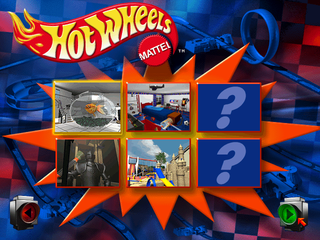
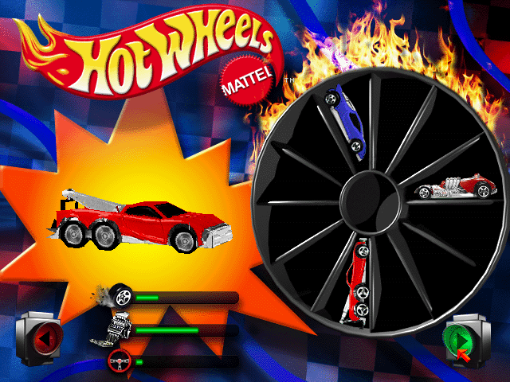
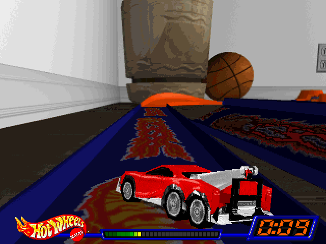

# Hot Wheels Stunt Track Driver port

Runs the 1998 Windows game *Hot Wheels Stunt Track Driver* on ARM Linux handhelds (Anbernic H700 family: RG35XXSP, RG34XXSP, …) as a [PortMaster](https://portmaster.games) package, using box64 + Wine. Game files are never included: the user supplies their own CD image.

| | |
|--|--|
|  |  |
|  |  |

## Install (PortMaster)

1. Download `hwstd.zip` from the [latest release](https://github.com/hiitsgabe/HWSTD_port/releases/latest) and extract it into your `ports/` folder (it creates `Hot Wheels Stunt Track Driver.sh` and `hwstd/`).
2. Copy everything inside the CD's `setup/hot98/` folder (`stunt.exe`, `data`, `menudata`, `saves`) into `ports/hwstd/gamedata/`, or drop the CD image (`.iso`) into `ports/hwstd/` and the port extracts it.
3. Refresh the game list and start *Hot Wheels Stunt Track Driver* from Ports. The first launch prepares Wine and takes a couple of minutes.

Needs PortMaster's Westonpack runtime (`weston_pkg_0.2`), downloaded automatically when missing.

## Why it works

`setup/hot98/stunt.exe` on the CD imports only `DDRAW` (`DirectDrawCreate`, `IDirectDraw2`), `DINPUT` and `DSOUND`. There is no Direct3D or Glide: the 3D is rendered in software into an 8-bit 640x480 surface (F1 in-race switches to 320x240 / 320x200). So Wine can present it through its GDI DirectDraw path (`HKCU\Software\Wine\Direct3D\renderer=gdi`) with no GPU at all, which sidesteps the Mali-G31 (GLES only, no Vulkan).

Verified in an Ubuntu 24.04 arm64 VM (OrbStack, Apple M1) with box64 (git main) and Wine amd64-wow64 builds: intro videos, menus and a 3D race all run. Findings:

- No installer and no CD check: copying `setup/hot98` is enough. The game reads the (empty) key `HKLM\Software\Mattel\Stunt Track Driver\1.0`.
- Without an audio device it stops at "Sound card not found, or fail in sound init." Any working ALSA/PulseAudio output fixes it.
- Menus read a relative DirectInput mouse; races use the arrow keys.
- `WINEDLLOVERRIDES="mscoree,mshtml="` avoids Wine's Mono/Gecko install prompt on first boot.
- About 245 MB RAM for the game process.

## Device notes (Knulli on H700)

- `/userdata` is exFAT: no symlinks. Wine ships as `wine.squashfs` and the prefix lives in `prefix.img` (ext4, 1 GB, created on first launch); both are loop-mounted under `/tmp/hwstd` only while the game runs.
- Wine 11.x aborts (`anon_mmap_alloc: Assertion !(size & host_page_mask)`) on the 4.9 kernel; Wine 10.0 works.
- box64 needs its bundled x86_64 `libgcc_s`/`libstdc++` (`box64/x64lib`, via `BOX64_LD_LIBRARY_PATH`).
- Wine processes end with SIGKILL even on success, so first-run setup checks the registry files instead of exit codes.
- First launch: about 2 minutes (image + wineboot). Later launches: about 50 seconds to the intro.
- The game crashes (null read at `004290b2`) while initialising the handheld's pad through DirectInput, so first-run setup disables WineBus joysticks; gptokeyb feeds keyboard + mouse instead. The launcher must export `SDL_GAMECONTROLLERCONFIG` for gptokeyb to see the pad.
- The screen is 720x480, so the 640x480 game sits at the left with a black bar on the right. A 640x480 Wine desktop (`explorer /desktop=...`) plus `WESTON_KIOSK_NO_RESIZE=1` centres it, but inside that desktop Esc during the intro quits the game, so it is not used.

## Layout

```
ports/hwstd/                      PortMaster port (same layout as PortMaster-New's ports/<name>/)
  Hot Wheels Stunt Track Driver.sh  launcher
  port.json, README.md, gameinfo.xml, screenshot.png
  hwstd/
    hwstd.gptk                    controls
    tools/isoextract.py           stdlib-only ISO9660 extractor (first run)
    licenses/
    box64/, wine.squashfs         built by tools/fetch_deps.sh (gitignored)
tools/
  fetch_deps.sh                   build box64 (native arm64 or Ubuntu 22.04 container) + Wine squashfs
  package.sh                      dist/hwstd.zip for manual installs / releases
  test_isoextract.sh              extractor check against a real mount (macOS)
android/                          Android APK build (Winlator fork), see android/README.md
docs/screenshots/
.github/workflows/
  portmaster.yml                  builds hwstd.zip on PRs and main (artifact)
  release.yml                     manual: builds and publishes a GitHub release
```

## Build

```bash
tools/fetch_deps.sh
tools/package.sh
```

`dist/hwstd.zip` is the same zip the release ships. CI builds it on every PR and push to main (artifact `portmaster-zip`); run the **Build and Release** workflow to publish a release.

## Status

- [x] Runs under box64 + Wine on arm64 (VM)
- [x] Package skeleton, ISO extraction
- [x] Plays on device (Knulli gladiator-ii, RG34XX-SP, H700, kernel 4.9): picture (left-aligned), audio, controls
- [ ] FPS measurement, other CFWs (muOS, ROCKNIX, ...)
- [ ] Controls for devices without analog sticks
